# 배틀 코치 (Battle Coach)

**포켓몬 싱글 배틀을 하면서, 한 턴마다 코치가 알려 주는 웹 학습 게임.**

체스닷컴의 수 평가처럼, 고른 행동에 등급(묘수 · 최선 · 실수 · 블런더 · 놓친 기회 …)과 한 줄 이유를 붙여 줍니다. 판이 끝나면 턴별로 복기하고, 실수한 턴은 같은 상황에서 다시 둬 볼 수 있어요.

**바로 해 보기: https://3.37.102.11.sslip.io** (설치 없이 브라우저에서, 폰도 돼요)

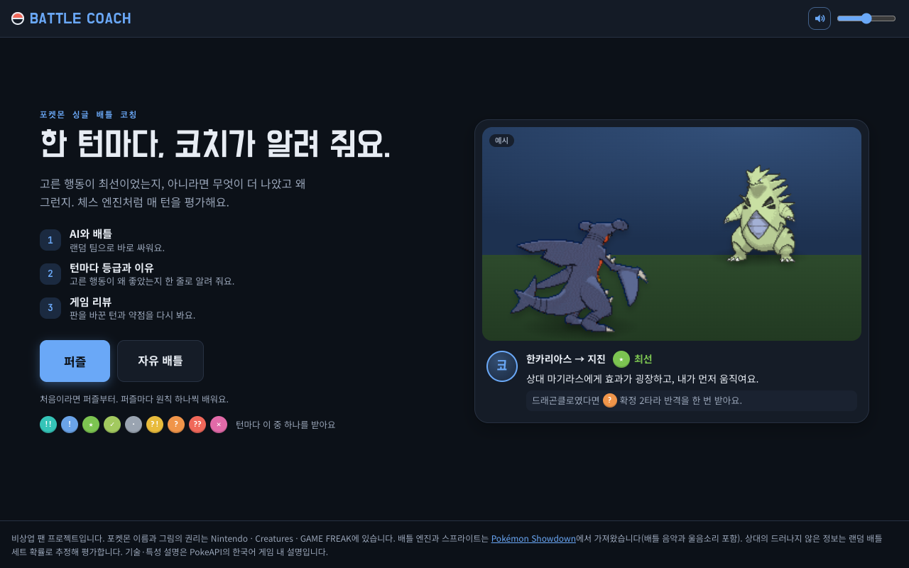

> 비상업 팬 프로젝트입니다. 포켓몬 이름과 그림의 권리는 Nintendo · Creatures · GAME FREAK에 있습니다. 자세한 출처는 [아래](#출처와-권리)에 있어요.

## 무엇을 할 수 있나

- **매 턴 등급과 이유** — 9단계 등급과 「이번 턴에 쓰러뜨릴 확률이 78%였어요」 같은 한 줄 설명. 기회가 왔는데 살리지 못한 턴은 **놓친 기회**로 따로 알려 줘요
- **두 가지 모드** — 랜덤 팀으로 싸우는 **자유 배틀**(3 대 3 포켓몬 챔피언스 규칙 / 6 대 6 9세대), 1단계부터 100단계까지 차례로 어려워지는 **퍼즐**
- **게임 리뷰와 다시 해 보기** — 정확도, 승률 흐름, 전환점, 약점. 실수한 턴을 같은 난수 · 같은 상대 행동으로 다시 두기
- **「이 평가가 이상해요」** — 코치 카드에서 누르면 그 턴의 상황이 서버에 저장돼서, 등급 기준을 다듬는 데 써요
- **뉴비 도움** — 상성 표시, 누가 먼저 움직이는지, 3단계 힌트, 상성 계산기, 포켓몬 정보 창, 한국어 이름과 기술 설명
- **배틀 연출** — 쇼다운의 움직이는 스프라이트, 턴 재생 애니메이션, 배틀 음악과 울음소리

## 화면

### 배틀 설정 · 퍼즐

| 자유 배틀 설정 | 퍼즐 |
| --- | --- |
| 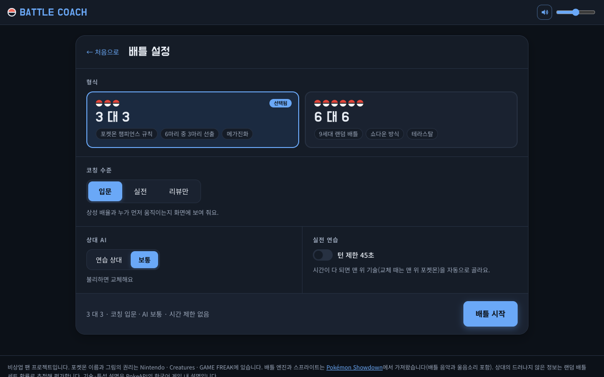 | 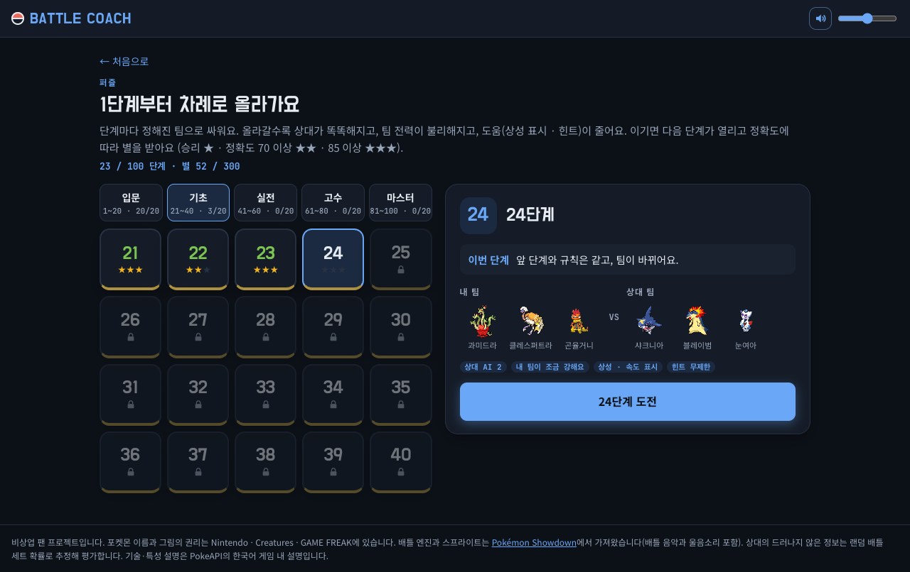 |

퍼즐은 1단계부터 100단계까지 있고, 20단계씩 다섯 묶음으로 나뉘어요. 단계마다 팀이 정해져 있고(모두 3 대 3, 포켓몬 챔피언스 규칙, 같은 팀은 한 번만 나와요), 이기면 정확도에 따라 별 1 ~ 3개를 받고 다음 단계가 열립니다.

난이도는 네 가지가 함께 올라가요. 묶음마다 한두 가지가 크게 바뀌고, 나머지는 단계마다 조금씩 움직여요.

| 묶음 | 상대 AI | 팀 전력 | 도움 |
| --- | --- | --- | --- |
| 1 ~ 20 입문 | 1단계 (가장 센 기술 위주), 실수 25% → 0% | 내 팀이 확실히 강함 | 상성 · 속도 표시, 힌트 무제한 |
| 21 ~ 40 기초 | 2단계 (불리하면 교체, 상태이상 사용), 실수 6% → 0% | 내 팀이 조금 강함 | 26단계부터 힌트 8번 → 5번 |
| 41 ~ 60 실전 | 2단계 | 비슷함 | 상성 · 속도 표시 끔, 힌트 5번 → 4번 |
| 61 ~ 80 고수 | 3단계 (코치와 같은 평가기로 수를 고름) | 비슷함 → 상대가 조금 강함 | 힌트 3번 → 2번 |
| 81 ~ 100 마스터 | 3단계 | 상대가 확실히 강함 | 턴 45초, 힌트 2번 → 0번 |

팀은 이렇게 골라요 (`npm run puzzles`, 약 40분):

1. 단계마다 목표 승률을 정해요 (1단계 93% → 100단계 30%).
2. 쇼다운 랜덤 배틀 레벨(강한 포켓몬일수록 낮게 매김)로 전력 차에 맞는 후보 팀 조합을 24개 만들어요.
3. 「적당히 잘하는 AI」가 플레이어 쪽을 맡아 후보마다 30판, 목표에 가까운 4개는 100판씩 더 싸워요.
4. 목표에 가장 가까운 조합을 골라요. 목표에서 5%p 넘게 벗어난 단계는 `npm run puzzles -- --retune`으로 후보를 3배 늘려 다시 찾아요.

지금 데이터는 100단계 중 95단계가 목표 승률 ±5%p 안이고, 가장 많이 벗어난 단계도 6%p예요.

한계도 있어요. 시뮬레이션의 플레이어는 사람이 아니라 AI라서 사람마다 체감은 달라요. 3단계 AI는 너무 느려서 시뮬레이션에서는 2단계로 대신 돌리므로 61단계부터는 표의 목표보다 실제로 더 어려워요. 상성 표시 · 힌트 · 타이머가 줄어드는 효과도 시뮬레이션에는 잡히지 않아요.

### 선출 (3 대 3)

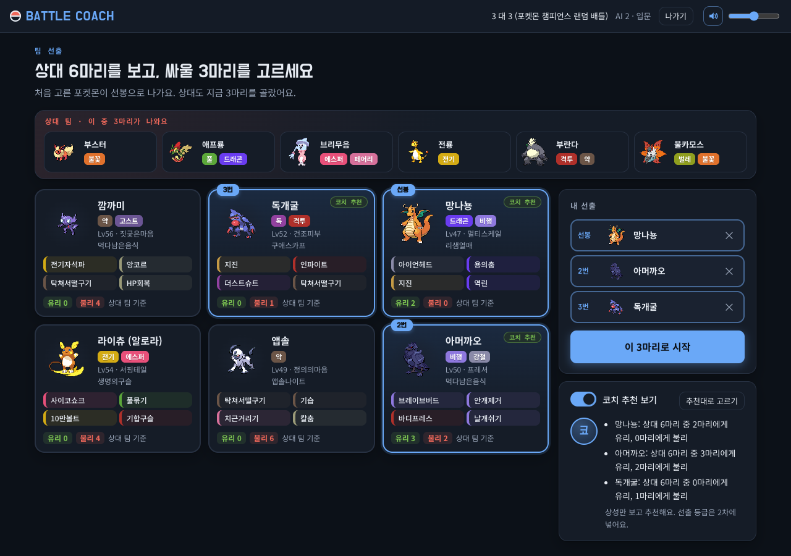

상대 6마리를 보고 내 3마리를 고릅니다. 「코치 추천 보기」를 켜면 추천 3마리와 카드마다 상대 팀 기준 유리 · 불리 수가 나와요 (먼저 혼자 골라 보라고 기본은 꺼져 있어요).

### 배틀

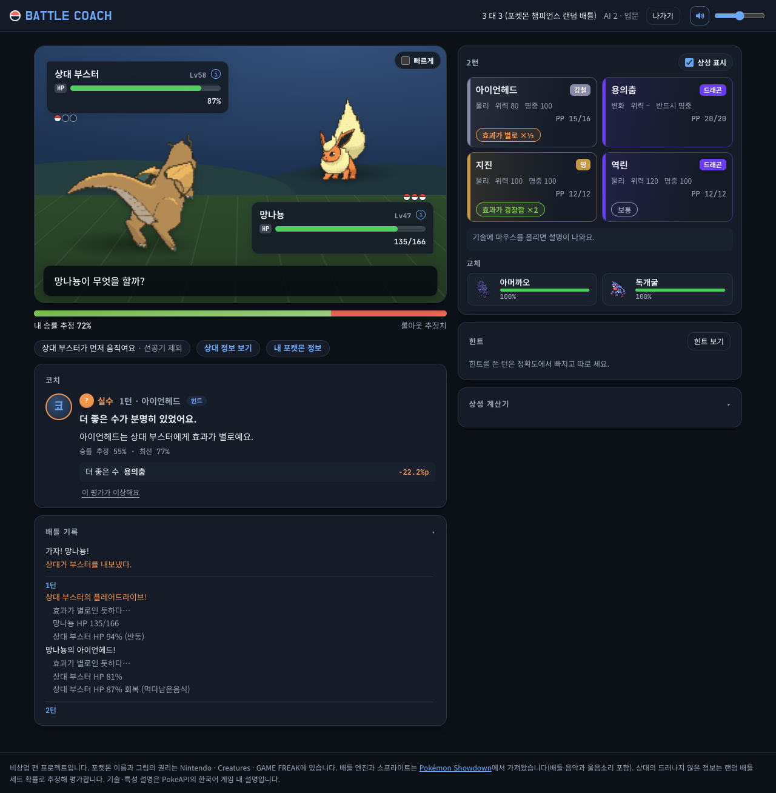

- 왼쪽: 필드, 승률 막대, 코치, 배틀 기록 / 오른쪽: 기술 4개 · 교체 · 힌트 · 상성 계산기 (스크롤해도 오른쪽은 고정)
- 기술 버튼에 타입, 위력, 명중, PP와 상성(「효과가 굉장함 ×2 / 보통 / 효과 없음」)이 붙어요
- 코치 카드는 그 턴의 재생이 끝난 뒤에 나와요

| 턴 재생 | 상성 계산기 |
| --- | --- |
| 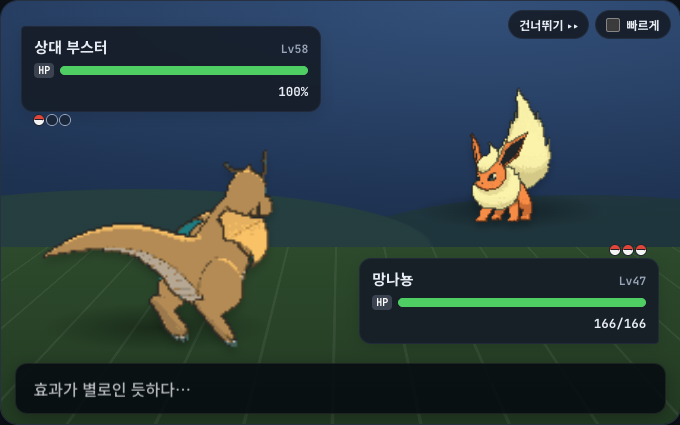 | 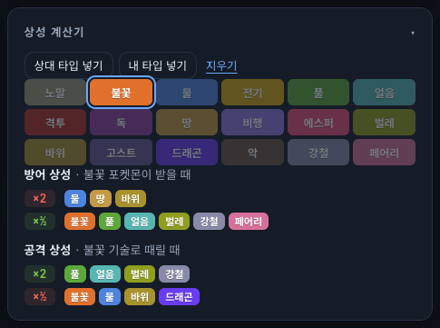 |

한 턴을 한 줄씩 재생해요. 물리 기술은 돌진, 특수 기술은 타입 색 구슬, 맞으면 흔들림과 번쩍임, 효과가 굉장하면 화면 흔들림, 쓰러짐, 메가진화 · 테라스탈 연출이 있어요. 상성 계산기는 타입을 1 ~ 2개 고르면 받는 피해와 주는 피해를 보여 줍니다.

### 포켓몬 정보 창

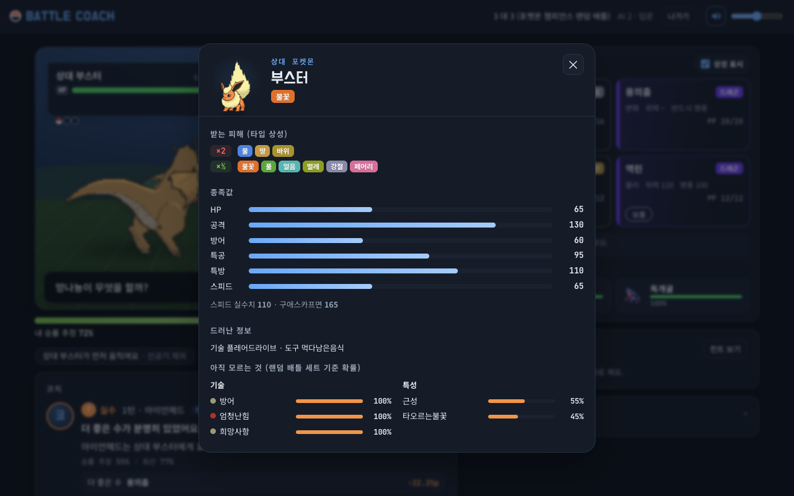

HUD를 누르면 타입 상성, 종족값, 스피드 실수치(구애스카프면 얼마)와 **아직 드러나지 않은 기술 · 도구 · 특성의 확률**이 나와요. 확률은 쇼다운 랜덤 팀 생성기를 수천 번 돌려 센 값입니다.

### 등급

| 등급 | 기준 (최선 행동과의 승률 차이) |
| --- | --- |
| 묘수 !! · 좋은 수 ! · 최선 ★ | 1%p 이하 (다른 수보다 크게 앞서거나, 남들이 놓칠 교체 · 메가진화 · 테라스탈이면 묘수) |
| 우수 ✓ · 무난 · | 3%p · 6%p 이하 |
| 부정확 ?! · 실수 ? · 블런더 ?? | 12%p · 25%p 이하 · 그 이상 |
| **놓친 기회 ✕** | 부정확 이하인데, 최선 기술로 60% 넘게 쓰러뜨릴 수 있었거나 직전보다 이길 확률이 12%p 넘게 올라간 턴 |

고를 수 있는 행동이 하나뿐이거나, 어떤 수를 둬도 비슷하거나, 이미 승부가 정해진 턴은 등급을 매기지 않아요.

### 게임 리뷰와 다시 해 보기

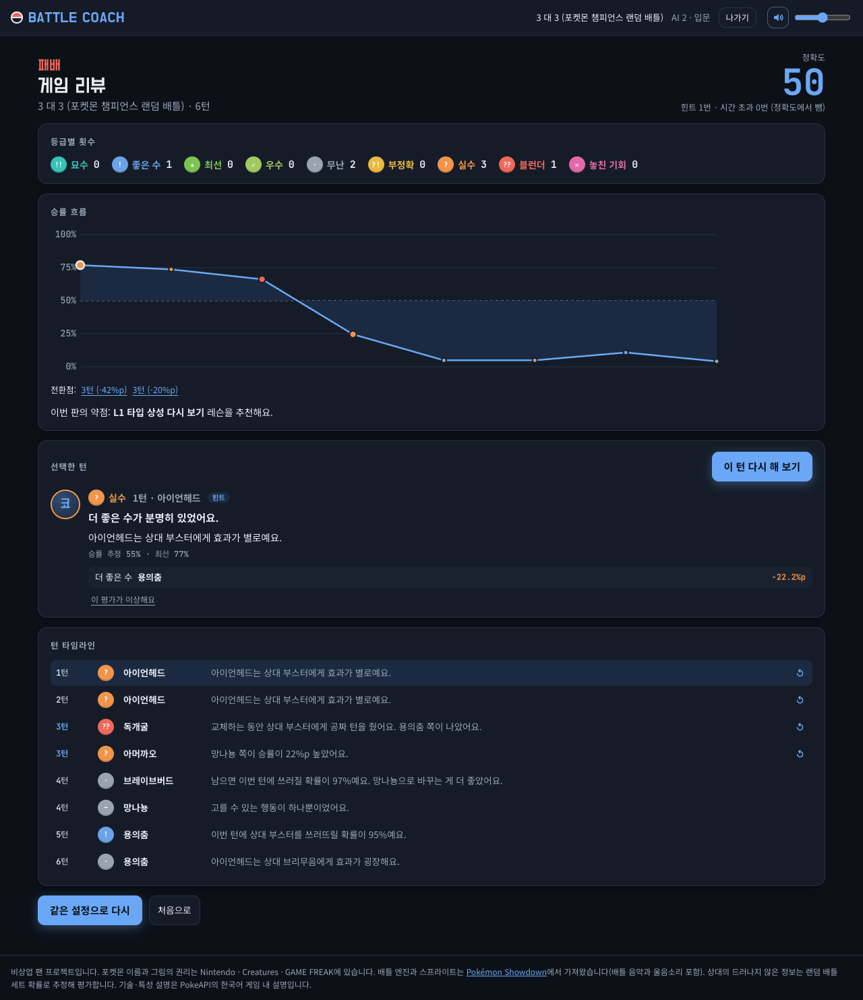

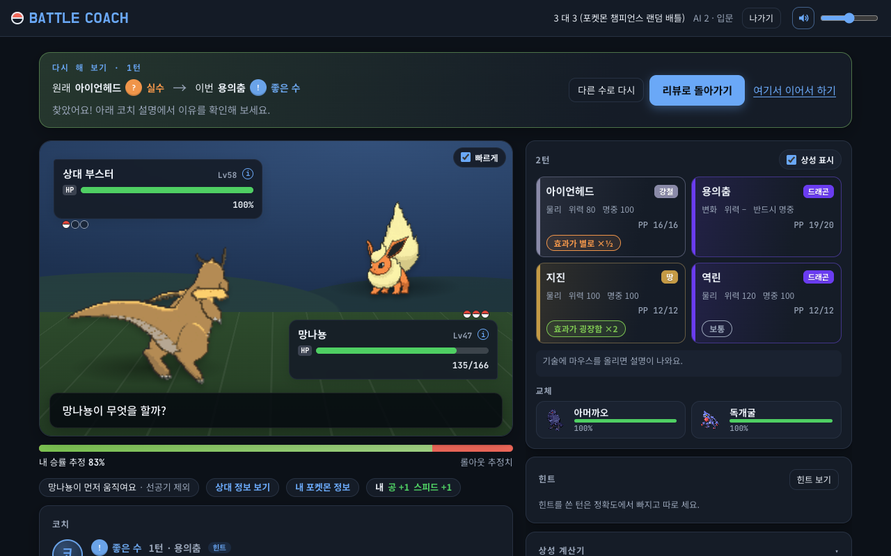

부정확 · 실수 · 블런더 · 놓친 기회 턴은 「이 턴 다시 해 보기」로 그 상황에 돌아가요. 난수와 상대 행동이 원래와 같아서, 결과가 달라지면 그건 선택 때문이에요.

### 폰

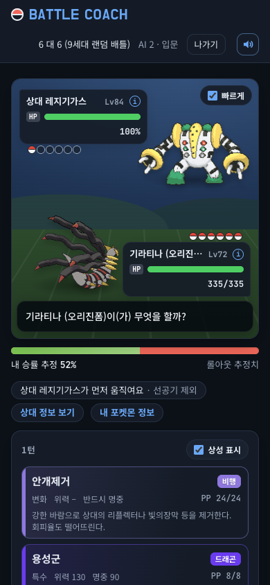

폰에서는 필드 → 기술 → 코치 순으로 쌓여요.

## 내 컴퓨터에서 실행

위 주소에서 바로 할 수 있어요. 고치거나 직접 띄우려면 Node.js가 필요해요 (24에서 확인했어요).

```bash
git clone https://github.com/Hellobot99/BattleCoach.git
cd BattleCoach
npm install
npm run dev
```

브라우저에서 http://localhost:5173 을 엽니다. 배틀 시뮬레이터와 평가기는 같은 명령으로 뜨는 로컬 서버에서 돌아요.

| 명령 | 하는 일 |
| --- | --- |
| `npm run dev` | 화면 + 배틀 서버 실행 |
| `npm run set-stats` | 쇼다운 랜덤 팀 생성기로 상대 세트 확률표를 다시 만들기 (`server/data/sets-*.json`) |
| `npm run ko-names` | PokeAPI에서 한국어 이름 · 설명을 다시 받기 (`server/data/ko-names.json`) |
| `npm run puzzles` | 퍼즐 100단계를 다시 만들고 시뮬레이션으로 난이도 맞추기 (`server/data/puzzles.json`, 약 40분). `-- --retune`은 목표에서 벗어난 단계만 다시 |
| `npm run stability` | 같은 위치를 여러 번 평가해 등급이 얼마나 흔들리는지 재기. `-- --feedback 파일`은 「이 평가가 이상해요」로 모인 턴을 다시 평가 |

### 서버에 배포

Docker로 띄울 수 있어요 (`Dockerfile`, `docker-compose.yml`: 앱 + Caddy 자동 HTTPS). 지금 사이트는 AWS EC2 t3.small에서 돌고, `main`에 푸시하면 GitHub Actions가 자동으로 배포해요. EC2 기준 순서, 인스턴스 크기별 실측 속도, 자동 배포 설정은 [DEPLOY.md](DEPLOY.md)에 있어요. 로컬에서 배포용으로 띄우려면 `npm run build && npm start` (포트 3000).

### 배틀 종료 음악 (선택)

`public/audio/victory.mp3`(이겼을 때), `defeat.mp3`(졌을 때)를 넣으면 배틀이 끝날 때 재생돼요. 없으면 직접 만든 짧은 팡파르가 나와요. 이 폴더의 음악 파일은 git에 올라가지 않아요. 원작 음원은 개인적으로만 넣어 쓰세요 ([안내](public/audio/README.md)).

## 코치는 어떻게 평가하나

머신러닝 없이 **몬테카를로 롤아웃**으로 평가해요.

1. 지금 턴에 고를 수 있는 행동마다(기술 · 테라 · 메가 · 교체, 최대 13개) 판을 복제해요.
2. 상대의 아직 드러나지 않은 기술 · 도구 · 특성 · 테라 타입과 안 나온 포켓몬은 랜덤 배틀 세트 확률대로 다시 뽑은 「가상의 판」 12개에서 계산해요. 코치가 플레이어가 모르는 정보를 쓰지 않게 하기 위해서예요.
3. 양쪽을 규칙 기반 AI로 4턴씩 굴리고, 끝나지 않으면 남은 체력으로 점수를 매겨요. 행동마다 24번 → 가망 있는 상위 6개는 72번 더.
4. 플레이어가 아직 고민 중이면, 최선에서 20%p 안에 드는 행동마다 32번씩 최대 3번 더 굴려요.
5. 최선 행동과의 기대 승률 차이(ΔW)로 등급을 매겨요 (위의 [등급](#등급) 표).

플레이어가 고민하는 동안 미리 계산해 두고, 워커 스레드 8개로 나눠 돌려서 첫 평가에 평균 0.8초 정도 걸려요 (Apple M4 기준). 상대 AI는 1 · 2단계가 규칙 기반이고, 3단계(퍼즐 후반)는 같은 평가기로 자기 수를 골라요.

### 등급이 얼마나 흔들리나

롤아웃은 무작위라서 같은 상황도 평가할 때마다 조금씩 달라요. `npm run stability`로 랜덤 판 30개 위치를 주사위만 바꿔 5번씩 평가해 쟀어요.

| 설정 | 좋음(최선 · 우수)과 나쁨(부정확 이하)이 뒤집힘 | 등급이 매번 같음 | 최선 행동이 같음 |
| --- | --- | --- | --- |
| 처음 (보강 없음, 가상의 판 12개) | 6.7% | 38% | 88% |
| **지금 (가상의 판 32개 + 고민하는 동안 보강)** | **3.5%** | **45%** | 87% |
| 지금 사이트 설정 (롤아웃 절반, 보강 포함) | 9.5% | 32% | 76% |

흔들림은 롤아웃 주사위와 상대 숨은 정보를 다시 뽑는 것에서 반반쯤 나와요. 「좋음 ↔ 나쁨」처럼 크게 틀리는 경우는 드물지만, 바로 옆 등급(우수 ↔ 무난, 부정확 ↔ 실수)끼리는 아직 자주 바뀌어요. 등급 기준값도 아직 플레이 테스트로 맞추지 않은 임시 값이에요. 「이 평가가 이상해요」로 모인 턴을 보고 다듬을 예정이에요.

## 구조

```
server/            배틀 서버 (개발 중엔 Vite 안에서, 배포 때는 prod.mjs로 돈다)
  game.mjs         한 판 진행, 한국어 배틀 기록, 드러난 정보 추적, 다시 해 보기
  evaluator.mjs    롤아웃 평가 (워커 스레드)
  rollout.mjs      롤아웃 한 번
  determinize.mjs  가상의 판: 상대 숨은 정보 다시 뽑기
  policy.mjs       규칙 기반 AI (상대 · 롤아웃 · 선출 추천)
  coach.mjs        등급, 이유 문장, 힌트, 리뷰 요약
  story.mjs        퍼즐 단계 (데이터는 scripts/build-puzzles.mjs가 만든다)
  feedback.mjs     「이 평가가 이상해요」 저장
  prod.mjs  api.mjs  배포용 서버와 JSON API
  data/            세트 확률표, 한국어 이름 · 설명
src/               화면 (React + TypeScript)
  Battle.tsx  Field.tsx  playback.ts   배틀 화면과 턴 재생
  Lobby.tsx  Story.tsx  Preview.tsx    첫 화면, 퍼즐, 선출
  ReviewScreen.tsx  InfoSheet.tsx  TypeCalc.tsx  sound.ts
scripts/           데이터 만드는 스크립트, 등급 흔들림 측정 (grade-stability.mjs)
```

## 아직 없는 것

- 레슨, 기록 화면
- 뉴비 대상 플레이 테스트로 등급 기준과 퍼즐 난이도 맞추기
- 데미지 계산기로 「확정 n타」 수치 붙이기, 이유 태그 더 늘리기
- 배포할 때 진행 중인 배틀 이어 가기 (지금은 서버를 다시 띄우면 사라져요)
- 9세대 신규 기술 · 특성 일부는 한국어 설명이 없어 쇼다운 영어 설명이 나와요

## 출처와 권리

- **비상업 팬 프로젝트**입니다. 광고나 결제가 없습니다. 포켓몬 이름, 그림, 음악의 권리는 Nintendo · Creatures · GAME FREAK에 있습니다. 권리자의 요청이 있으면 내립니다.
- 배틀 엔진: [Pokémon Showdown](https://github.com/smogon/pokemon-showdown) (MIT). 스프라이트, 배틀 음악, 울음소리는 저장소에 넣지 않고 쇼다운 서버에서 불러옵니다.
- 한국어 이름과 게임 내 설명: [PokeAPI](https://github.com/PokeAPI/pokeapi) 데이터
